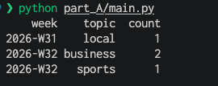

# Part A: Cleaning articles and weekly counts

**Task:** clean a list of articles that has duplicate titles and mixed date formats, then count how many articles were published per topic per calendar week.

## How it works

`ArticleProcessor` in [parse.py](parse.py) runs four steps in order:

1. **Normalize text.** Trims extra spaces from titles and lowercases topics, so "Local" and "local" count as the same topic.
2. **Normalize dates.** Each date is parsed against two known formats, `YYYY-MM-DD` and `MM/DD/YYYY`. A date in any other format raises an error instead of being guessed.
3. **Remove duplicates.** Articles with the same title (ignoring case) are treated as one, and the first is kept.
4. **Count by week and topic.** Groups the articles by ISO week and topic.

The order matters. The two "City Council Approves New Transit Line" entries only match once their topics and dates are in the same format, so cleaning has to come before removing duplicates.

## Assumptions

- **`08/01/2026` means August 1, not January 8.** It duplicates the article dated `2026-08-01`, so I read slash dates as US month/day.
- **A calendar week runs Monday to Sunday (ISO weeks).** This choice changes the result. August 9 is a Sunday, so if weeks started on Sunday, the two business articles would land in different weeks.
- **Duplicates are matched on title alone**, as the task describes.

## Run

From the repository root:

```bash
python part_A/main.py
```

## Output



Five articles go in, one duplicate is removed, and the remaining four are counted across two weeks.
