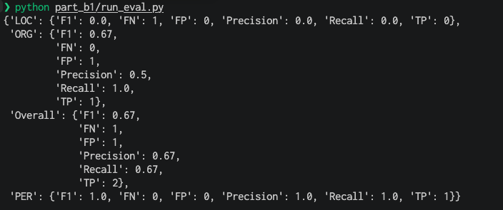

# Part B1: Evaluating entity extraction

**Task:** score an LLM's extraction of people, organizations and locations against a reference, and explain which errors matter more.

> Maria Gomez, CEO of Northwind Logistics, announced a partnership with the city of Denver.

| | People | Organizations | Locations |
|---|---|---|---|
| Reference | Maria Gomez | Northwind Logistics | Denver |
| LLM output | Maria Gomez | Northwind Logistics, Denver | (none) |

## How it works

Each entity is stored as a (name, type) pair, like `("Denver", "LOC")`. A prediction only counts as correct when both the name and the type match, so Denver labeled as an organization is a mistake.

[eval.py](eval.py) compares the two sets:

- **True positives:** pairs in both the reference and the prediction
- **False positives:** pairs the LLM predicted that aren't in the reference
- **False negatives:** pairs in the reference that the LLM missed

`evaluate_per_type` scores each entity type on its own, then scores all pairs together for the overall result.

Two edge cases: when nothing is predicted for a type, precision is 0/0, and I report it as 0. When the reference and prediction are both empty, the model did exactly the right thing, so all three scores are 1.0.

## Results

| Type | TP | FP | FN | Precision | Recall | F1 |
|---|---|---|---|---|---|---|
| People | 1 | 0 | 0 | 1.00 | 1.00 | 1.00 |
| Organizations | 1 | 1 | 0 | 0.50 | 1.00 | 0.67 |
| Locations | 0 | 0 | 1 | 0.00 | 0.00 | 0.00 |
| **Overall** | 2 | 1 | 1 | **0.67** | **0.67** | **0.67** |

## Which errors matter more

**There's only one mistake here, and it gets counted twice.** The LLM found "Denver" but gave it the wrong type. Strict scoring counts that as a false positive under organizations and a false negative under locations, so the overall score drops to 0.67 even though every entity was found. If you only check names, the score is 1.0.

**The LLM's label is arguably fair.** In "a partnership with the city of Denver", the partner is the city government, which behaves like an organization. Some annotation schemes have a separate geopolitical type for exactly this case. Clearer labeling rules in the prompt would fix most of it.

**In general, I'd rank errors like this, worst first:**

1. Invented entities that aren't in the text, because they add false facts
2. Missed entities, especially the main person in a story
3. The right entity with the wrong type, like here, because the entity is still found and the type can often be corrected later

**Whether precision or recall matters more depends on the use.** If the output feeds a knowledge graph, precision matters more, since Denver filed as a company is bad data. If it feeds search or a local news feed, recall matters more, since this article would never show up for Denver.

## Run

From the repository root:

```bash
python part_b1/run_eval.py
```

## Output


