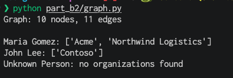

# Part B2: Modeling entities as a graph

**Task:** build a graph where a Person works at an Organization, an Organization is located in a Location, and an Article mentions a Person or Organization. Then write a query that finds every organization mentioned in the same article as a given person.

## How it works

[graph.py](graph.py) uses a directed networkx graph (`MultiDiGraph`). Every entity is a node with a `kind` (Person, Organization, Location or Article), and every relationship is an edge with a `rel` label (`worksAt`, `locatedIn` or `mentions`).

- **Node IDs include the type,** like `Person:Maria Gomez`. That keeps two entities with the same name apart, such as Denver the location and Denver the city government.
- **A schema checks every edge.** Only the relations from the task are allowed, and only between the right kinds of node. Making an article mention a location, for example, raises an error instead of quietly adding bad data.

## The query

`orgs_mentioned_with(person)` walks two hops:

```
Person  ← mentions ←  Article  → mentions →  Organization
```

1. Follow `mentions` edges backwards from the person to find every article that mentions them.
2. Follow `mentions` edges forwards from each of those articles and keep the organizations.

Results go into a set, so an organization mentioned in several articles shows up once. A person who isn't in the graph gets an empty result.

Only `mentions` edges are used, because the question is about appearing in the same article. Working at a company through `worksAt` doesn't count on its own.

In a graph database like Neo4j, the same query is one line of Cypher:

```cypher
MATCH (p:Person {name: $name})<-[:MENTIONS]-(:Article)-[:MENTIONS]->(o:Organization)
RETURN DISTINCT o.name
```

## Sample data

| Article | Mentions |
|---|---|
| A1 | Maria Gomez, Northwind Logistics |
| A2 | Maria Gomez, Northwind Logistics, Acme |
| A3 | John Lee, Contoso |

The graph also has Maria working at Northwind (in Denver) and John working at Contoso (in Seattle). A3 is there to show the filter working: Contoso never appears in Maria's results because no article mentions them together.

## Run

From the repository root:

```bash
python part_b2/graph.py
```

## Output


